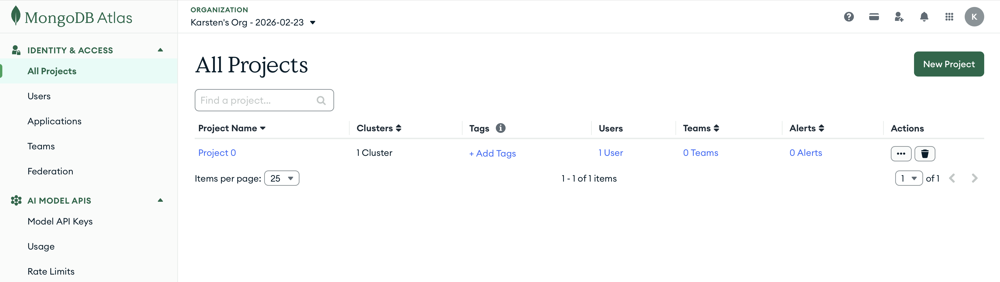
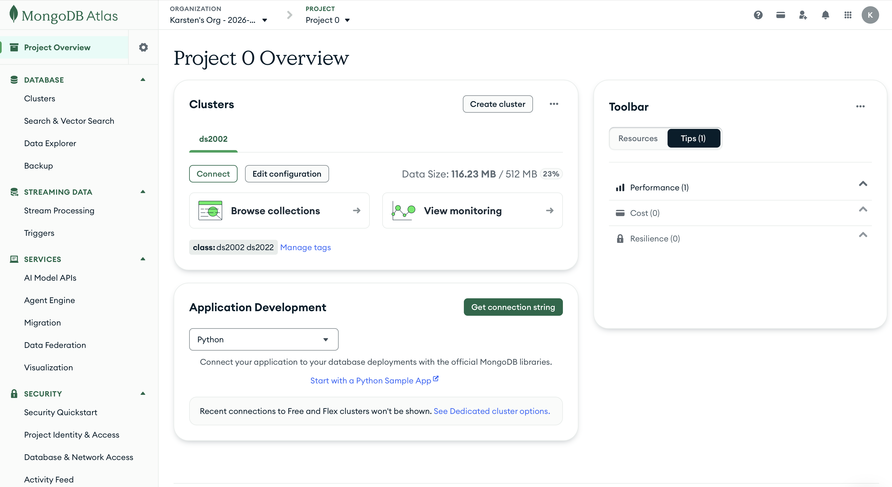
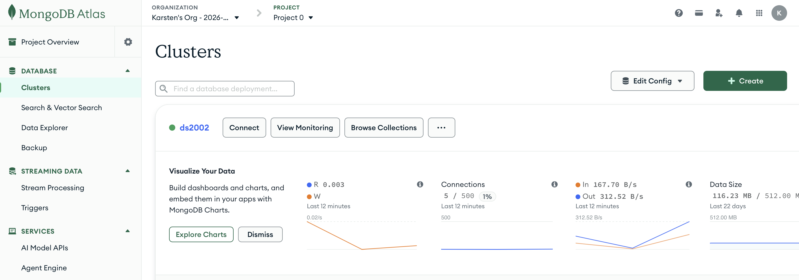
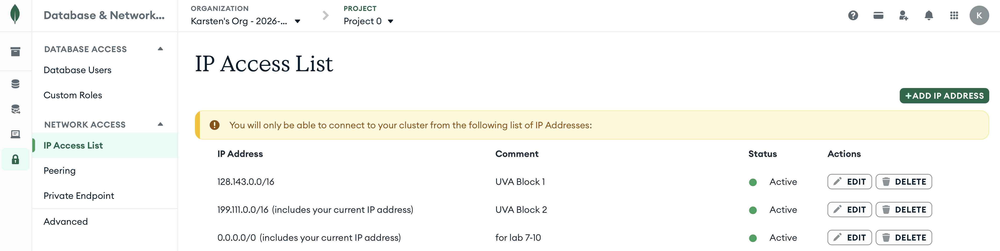

# Lab 07: Analyze Books on Amazon EC2 and AWS Lambda

> [!CAUTION]
> **Do NOT click Reset in the AWS Academy Learner Lab unless your instructor tells you to.**
> Reset permanently deletes everything in your lab account (S3 buckets, EC2 instances, Lambda functions, ...) and cannot be undone. To pause, click **End Lab**: your resources stay and are back with the next **Start Lab**.

In [Lab 06](https://github.com/ksiller/lab-06-s3) you staged 100 Project Gutenberg books in your bucket `public-mst3k`. In this lab you analyze them in the cloud, in two ways:

1. **Part 1: Amazon EC2, as one batch job.** You launch a virtual machine that installs its own software, clones this repository at boot, and analyzes every book in your bucket. The results go into your MongoDB Atlas cluster from [Lab 05](https://github.com/ksiller/lab-05-nosql), one document per book.
2. **Part 2: AWS Lambda, one event at a time.** You build a Chalice app around the same analysis code and deploy it as a Lambda function. Every book you upload afterwards is analyzed automatically, within seconds, with no machine running.
3. **Part 3: A query of your own.** You add a table to the report, for example one that compares the vocabulary of the books or counts the books by author.

You do not write analysis code in this lab. It is provided in `src/book_analysis/analyze.py`. Your work is to run it on EC2, build the Lambda app around it, add one query to the report, and document the results.

> [!IMPORTANT]
> `mst3k` is a placeholder. Replace it everywhere with your UVA computing ID, for example `public-mst3k` → `public-abc2de`. If your Lab 06 bucket has a different name, use that name.

## Schedule: two weeks, one submission

| Week | Do                                                                                                                | Milestone                                                                            |
| ---- | ----------------------------------------------------------------------------------------------------------------- | ------------------------------------------------------------------------------------ |
| 1    | [Setup](#setup) and [Part 1: EC2](#part-1-analyze-all-books-on-ec2)                                               | your 100 books analyzed on EC2, terminate instance when completed                    |
| 2    | [Part 2: Lambda](#part-2-build-a-lambda-app-for-new-books) and [Part 3: query](#part-3-add-a-query-to-the-report) | on-demand automatic processing with Chalice app (Lambda) when a new book is uploaded |

You submit **once**, at the end of week 2, for all three parts (see [Submit your work](#submit-your-work)). Each part ends with a milestone checklist: finish it before you move on.

## Learning goals

**Part 1: Virtual machines (EC2)**

- Understand what a virtual machine (VM) is
- Provision a VM in AWS (EC2) from the command line
- Connect to an EC2 instance with `ssh`
- Customize an EC2 instance at launch: install software and your own code with a startup script
- Understand the life cycle of an EC2 instance: launch, run, stop, terminate

**Part 2: Serverless computing (AWS Lambda)**

- Understand what serverless computing is, and how event-driven processing differs from a batch job
- Know the use cases for a server (EC2) vs. serverless compute (AWS Lambda)
- Build a Lambda function as a Chalice app:
  - Create a Chalice project and know what each of its files is for
  - Package your own code (`chalicelib/`) and the packages it needs (`requirements.txt`)
  - Trigger the function with an event: here, an upload to S3
- Deploy the Chalice app to AWS:
  - Configure the deployment: IAM role, memory, and timeout (`.chalice/config.json`)
  - Deploy with `chalice deploy`, and know what it creates in AWS: the function, the permission for S3 to invoke it, and the bucket's event notification
  - Check and debug the deployed function with its logs (`chalice logs`)

**Part 3: Querying the results**

- Query MongoDB from Python with PyMongo: `find`, `sort`, `limit`, `distinct`, and `count_documents`

The lab builds on:

- [Lab 05: NoSQL with MongoDB](https://github.com/ksiller/lab-05-nosql): your Atlas cluster stores the results
- [Lab 06: Working with S3](https://github.com/ksiller/lab-06-s3): your bucket holds the books
- [Class 07: EC2](https://github.com/ksiller/DS2022/blob/main/class/07-ec2/README.md)
- [Class 07: Lambda](https://github.com/ksiller/DS2022/blob/main/class/07-lambda/README.md)

## What is in this repository

```text
lab-07-ec2-lambda/
├── README.md
├── pyproject.toml              # uv project: boto3, pymongo, nltk, chalice
├── uv.lock
├── bootstrap.sh                # EC2 startup script: tools + this repo (Part 1)
├── src/book_analysis/
│   ├── analyze.py              # the analysis: books in S3 → MongoDB
│   └── report.py               # proof of completion; your query (Part 3)
├── chalice-config.json         # Lambda deployment settings (Part 2)
├── docs/                       # screenshots for this README
└── CLAUDE.md                   # background for Claude Code, if you use it
```

You add three things yourself: the Chalice app `book-analyzer/` (Part 2), and `RESULTS.md` with the folder `results/` for your submission. `README.md` stays as it is.

You run the two scripts in `src/book_analysis/` with `uv run python`, from the top folder of your clone. `uv run python src/book_analysis/analyze.py public-mst3k` analyzes every `.txt` file in the bucket. `uv run python src/book_analysis/report.py` prints what is in your database. `uv run` uses the project's environment, with all packages from `pyproject.toml`.

## What is computed

`analyze.py` computes the same fields wherever it runs. You look at how it does that in Setup step 6, [The analyze.py script](#6-the-analyzepy-script). Each book becomes one document in the collection `books` of the database `gutenberg` on your Atlas cluster, for example:

```json
{
  "_id": "pg11.txt",
  "title": "Alice's Adventures in Wonderland",
  "author": "Lewis Carroll",
  "language": "English",
  "gutenberg_release": "June 27, 2008",
  "word_count": 27427,
  "unique_words": 2575,
  "unique_lemmas": 2045,
  "vocabulary_ratio": 0.0746,
  "runs": [
    {"host": "my-laptop",      "at": "2026-10-27T14:41:05Z"},
    {"host": "ip-172-31-5-20", "at": "2026-10-27T15:02:11Z"}
  ]
}
```

| Field                         | Meaning                                                                                                             |
| ----------------------------- | ------------------------------------------------------------------------------------------------------------------- |
| `_id`                         | the object key of the corresponding book text file in your S3 bucket, for example `pg11.txt`                        |
| `title`, `author`, `language` | from the `Title:`, `Author:`, and `Language:` lines at the top of the file                                          |
| `gutenberg_release`           | when Project Gutenberg published the eBook (`Release date:`), **not** when the book was written                     |
| `word_count`                  | how many words are in the book (a word is a run of letters and apostrophes, in lowercase)                           |
| `unique_words`                | how many distinct words are in the book                                                                             |
| `unique_lemmas`               | how many distinct dictionary forms (lemmas) are in the book: "run", "runs", "running", and "ran" all count as "run" |
| `vocabulary_ratio`            | `unique_lemmas / word_count`: a rough measure of how varied the author's vocabulary is                              |
| `runs`                        | **one entry per analysis**: the date of processing (`at`) and the machine it ran on (`host`)                        |

`runs` is your proof of completion. After Part 1, your 100 books list the host name of *your* EC2 instance. After Part 2, the book you uploaded lists the host name of the Lambda environment that analyzed it.

## Setup

### 1. Prepare your MongoDB Atlas cluster

You use your Atlas cluster from [Lab 05](https://github.com/ksiller/lab-05-nosql). First check that your `MONGODB_ATLAS_*` environment variables from Lab 05 are still set. The output includes your password, so do not run this while sharing your screen:

```bash
printenv | grep -i mongo
```

You should see `MONGODB_ATLAS_URL`, `MONGODB_ATLAS_USER`, and `MONGODB_ATLAS_PWD`. If any of them is missing, follow [MongoDB Atlas setup](https://github.com/ksiller/DS2022/blob/main/setup/mongodb.md) again. If you just updated your `~/.zshrc` or `~/.bashrc`, close your terminal and open a new one. The environment variables are then loaded; confirm with `printenv | grep -i mongo`.

**Make sure your cluster is running.**

1. Log in at [cloud.mongodb.com](https://cloud.mongodb.com). Atlas opens **All Projects**. Click the project that holds your Lab 05 cluster (usually **Project 0**):

   

2. The **Project Overview** shows your cluster under **Clusters**. In the menu on the left, under **Database**, click **Clusters**:

   

3. A green dot next to the cluster's name means it is running. If the cluster shows **Paused** and a **Resume** button instead, click **Resume** and wait a few minutes until the dot is green:

   

**Allow access from anywhere.** In Lab 05 you allowed only UVA addresses. Your EC2 instance gets a new public address every time it starts, and a Lambda function has no fixed address at all, so Atlas must accept connections from any address.

1. In the menu on the left, under **Security**, click **Database & Network Access**, then **IP Access List**.
2. Click **+ Add IP Address**.
3. Click **Allow Access from Anywhere**. The field **Access List Entry** now shows `0.0.0.0/0`. Enter a comment such as `Labs 07-10`, and click **Confirm**.
4. Wait until the new entry's **Status** is **Active** (about a minute). Your list now looks like this, with the UVA entries from Lab 05 and `0.0.0.0/0`:

   

Leave this entry in place for the rest of the semester: Lab 08 and Lab 10 need it too. From now on, your database user's password is the only thing that protects the cluster, so never commit it or share it.

**Check the connection.** Check that you can reach the cluster from your computer:

```bash
mongosh "$MONGODB_ATLAS_URL" --apiVersion 1 --username "$MONGODB_ATLAS_USER" --eval "db.runCommand({ping: 1})"
```

Enter your Atlas password when asked. The output should report `{ ok: 1 }`.

### 2. Fork and clone this repository

Fork this repository on GitHub (keep the default name): [https://github.com/ksiller/lab-07-ec2-lambda](https://github.com/ksiller/lab-07-ec2-lambda). Clone **your fork** to your own computer:

```bash
mkdir -p ~/ds2022-fall-2026/
cd ~/ds2022-fall-2026/
git clone https://github.com/YOUR_USERNAME/lab-07-ec2-lambda.git
cd lab-07-ec2-lambda
```

Do all of your work in this directory, in the **terminal on your computer** unless a step says otherwise.

### 3. Python environment

The project is already set up. Create the environment from `pyproject.toml` and `uv.lock`:

```bash
uv sync
uv run python src/book_analysis/analyze.py --help
```

`uv sync` also downloads Python 3.13 if you do not have it. If `uv` is missing, install it with [Installing uv](https://docs.astral.sh/uv/getting-started/installation/).

### 4. Start the Learner Lab and configure the AWS CLI

1. On the AWS Academy **Learner Lab** page, click **Start Lab** and wait for the green **AWS** icon. **Do not click Reset**: it deletes your Lab 06 buckets.
2. Click **AWS Details** → **AWS CLI** → **Show**, and paste the block into `~/.aws/credentials`. The credentials change with every lab session.
3. Confirm the contents of both AWS CLI files. The output includes your secret key and session token, so do not run this while sharing your screen:

   ```bash
   cat ~/.aws/credentials
   cat ~/.aws/config
   ```

   `~/.aws/credentials` must contain the block you just pasted, with each value on a single line. `~/.aws/config` must set the region and output format:

   ```text
   [default]
   aws_access_key_id=ASIA...
   aws_secret_access_key=...
   aws_session_token=...
   ```

   ```text
   [default]
   region = us-east-1
   output = json
   ```

   If a file is missing or looks different, follow [AWS CLI configuration](https://github.com/ksiller/lab-06-s3#4-aws-cli-configuration-temporary-credentials) in Lab 06.

4. Check that the CLI works and that your Lab 06 bucket still has the books:

   ```bash
   aws sts get-caller-identity
   aws s3 ls s3://public-mst3k/ | grep -c '\.txt$'
   ```

   The second command counts the books. The number should be `100`. If the bucket is empty or missing, finish [Lab 06](https://github.com/ksiller/lab-06-s3) first.

### 5. Store your Atlas settings in SSM Parameter Store

On your computer, `analyze.py` reads the three Lab 05 environment variables. The EC2 instance and the Lambda function do not have them, and they must not be in a file you commit. **AWS Systems Manager Parameter Store** keeps such values in your AWS account. When the environment variables are missing, `analyze.py` reads the parameter `mongodb_credentials` instead (see `get_atlas_settings()`), with the role `LabRole` on EC2 and Lambda.

Store the three values as one JSON value, copied from your environment variables:

```bash
aws ssm put-parameter --name mongodb_credentials --type SecureString --overwrite \
  --value "{\"url\": \"$MONGODB_ATLAS_URL\", \"user\": \"$MONGODB_ATLAS_USER\", \"password\": \"$MONGODB_ATLAS_PWD\"}"
```

`SecureString` stores the value encrypted. Check it:

```bash
aws ssm get-parameter --name mongodb_credentials --with-decryption --query Parameter.Value --output text
```

The output must be valid JSON with your URL, user, and password. You can also see the parameter in the **AWS Console**: open **Systems Manager** → **Parameter Store** (or type `Parameter Store` in the console's search bar) and click `mongodb_credentials`. The value stays hidden until you click **Show decrypted value**; do not do that while sharing your screen. If your password contains a `"` or a `\`, the JSON breaks: change the password in Atlas (**Database Access** → **Edit**) and in your shell configuration, then run the `aws ssm put-parameter` and `aws ssm get-parameter` commands above again.

If `put-parameter` fails with a KMS `AccessDenied` error, run it again with `--type String` (and leave out `--with-decryption` when you check). The value is then stored unencrypted in your AWS account, and it is still not in your repository.

This is a good example where you can also use Claude Code as an assistant (see [Using Claude Code](#using-claude-code)). To put or get the parameter, use these prompts:

**Put parameters**

```text
Store my MongoDB Atlas settings from the environment variables MONGODB_ATLAS_URL, MONGODB_ATLAS_USER, and MONGODB_ATLAS_PWD as one JSON value in the SSM parameter mongodb_credentials, type SecureString. Do not print the password.
```

**Get parameters**

```text
Check that the SSM parameter mongodb_credentials is valid JSON with the keys url, user, and password. Do not print the password.
```

### 6. The analyze.py script

In the next step you run `analyze.py` on your computer. Parts 1 and 2 run the same file on EC2 and in Lambda. Open [src/book_analysis/analyze.py](src/book_analysis/analyze.py) next to this table; the functions are listed in the order the analysis uses them:

| Function               | What it does                                                                                                                                                  | Called by                                    |
| ---------------------- | ------------------------------------------------------------------------------------------------------------------------------------------------------------- | -------------------------------------------- |
| `get_atlas_settings()` | returns the Atlas URL, user, and password: from the environment variables on your computer, from the SSM parameter `mongodb_credentials` on EC2 and in Lambda | `connect()`                                  |
| `connect()`            | connects to Atlas and returns a client; the caller closes it in `finally`, also after an error                                                                | `main()`, `analyze_book()`                   |
| `get_book_keys()`      | returns the keys of all `.txt` files in the bucket                                                                                                            | `main()`                                     |
| `download()`           | returns the text of one book in S3                                                                                                                            | `main()`, `analyze_book()`                   |
| `read_header()`        | takes title, author, language, and release date from the header                                                                                               | `process()`                                  |
| `extract_book_text()`  | returns the text of the book itself, without Project Gutenberg's header and license                                                                                       | `process()`                                  |
| `lemmatize()`          | reduces each word to its dictionary form with NLTK                                                                                                            | `process()`                                  |
| `process()`            | computes all fields of one book                                                                                                                               | `main()`, `analyze_book()`                   |
| `save()`               | writes one book's document to Atlas and records the run                                                                                                       | `main()`, `analyze_book()`                   |
| `main()`               | **entry point when you run** `analyze.py`: analyzes every book in the bucket, one after another (your computer, EC2)                                          | `uv run python src/book_analysis/analyze.py` |
| `analyze_book()`       | **entry point for Lambda**: analyzes one book                                                                                                                 | your `app.py` (Part 2)                       |

`read_header()` takes the metadata from the header that every Project Gutenberg file starts with. Then `extract_book_text()` cuts that header and the license at the end away, and returns only the text of the book, which is what gets counted. The files do not say when a book was first published or what genre it is.

`lemmatize()` uses the [NLTK](https://www.nltk.org/) library: first `nltk.pos_tag` finds out whether a word is a noun, verb, adjective, or adverb, then the WordNet lemmatizer looks up its base form ("whispered" → "whisper", "mice" → "mouse"). The first run on a machine downloads the NLTK data it needs (about 12 MB) into the temporary folder. To learn more, read [Lemmatisation](https://en.wikipedia.org/wiki/Lemmatisation) on Wikipedia.

`save()` writes each document with one `update_one(..., upsert=True)`: `$set` replaces the statistics, and `$push` appends the run to `runs`. A second run updates the numbers and keeps the history. Lab 08 adds more fields to the same documents.

Claude Code can walk you through the code (see [Using Claude Code](#using-claude-code)). Use these prompts, and replace `extract_book_text` with any function from the table:

**Explain one function**

```text
Explain the function extract_book_text in src/book_analysis/analyze.py. Tell me how it is called, what parameters it expects, and what it returns.
```

**Explain the whole script**

```text
Explain the logic and flow of the script src/book_analysis/analyze.py, from main() and from analyze_book().
```

Answer for yourself:

- Which function does `analyze.py` start with when you run it, and which one will your Lambda function call?
- Why do `main()` and `analyze_book()` both call `connect()`, `download()`, `process()`, and `save()`?

### 7. Test on your computer

Analyze three books from your computer, then print the report:

```bash
uv run python src/book_analysis/analyze.py public-mst3k --limit 3
uv run python src/book_analysis/report.py
```

The report shows one row with your computer's name and 3 books. If this works, S3 and Atlas are set up correctly. In `mongosh` (as in Lab 05), `use gutenberg` and `db.books.findOne()` show one of the documents.

**Test the Atlas settings in Parameter Store.** The EC2 instance and the Lambda function do not have your `MONGODB_ATLAS_*` environment variables. When `MONGODB_ATLAS_URL` is not set, `analyze.py` reads your Atlas settings from the SSM parameter `mongodb_credentials` instead (Setup step 5). Test this before you launch the instance, by running `analyze.py` once without that variable:

```bash
env -u MONGODB_ATLAS_URL uv run python src/book_analysis/analyze.py public-mst3k --limit 1
```

`env -u MONGODB_ATLAS_URL` removes the variable for this one command only; your terminal keeps it. The last line should again read `Processed 1 books from s3://public-mst3k ...`. If the command fails with `Cannot read SSM parameter mongodb_credentials`, repeat Setup step 5.

## Part 1: Analyze all books on EC2

**The Case:** 100 books are a batch job: start a machine, process everything, shut it down. The machine must install its own software and get the code, because nobody should have to set it up by hand.

### Step 1: Read the bootstrap script

Open [bootstrap.sh](bootstrap.sh). Passed to the instance as **user data**, it runs once, as root, when the instance boots for the first time. It automatically installs `git`, `curl`, Python 3 and `uv`, and clones this repository into `/home/ubuntu/lab-07-ec2-lambda` on the new EC2 instance when it is provisioned. Answer for yourself:

- Why does the script end with `chown`, and what would go wrong without it?
- Why is there no database password and no AWS key in this file?

### Step 2: Launch the instance

Start Lab and update `~/.aws/credentials` if your session expired. Then launch one instance. The command is the one from [Class 07: EC2](https://github.com/ksiller/DS2022/blob/main/class/07-ec2/README.md), plus two options:

```bash
IID=$(aws ec2 run-instances \
  --image-id ami-0b6d9d3d33ba97d99 \
  --instance-type t3.micro \
  --key-name vockey \
  --security-groups launch-wizard-1 \
  --iam-instance-profile Name=LabInstanceProfile \
  --user-data file://bootstrap.sh \
  --tag-specifications 'ResourceType=instance,Tags=[{Key=Name,Value=lab07-mst3k}]' \
  --query 'Instances[0].InstanceId' --output text)
echo "Instance ID: $IID"
```

| Option                                           | Why                                                                                                               |
| ------------------------------------------------ | ----------------------------------------------------------------------------------------------------------------- |
| `--iam-instance-profile Name=LabInstanceProfile` | gives the instance the role `LabRole`, so code on it can read S3 and Parameter Store without `~/.aws/credentials` |
| `--user-data file://bootstrap.sh`                | the CLI reads `bootstrap.sh` from your computer and hands it to the instance, which runs it at first boot         |

`launch-wizard-1` is the security group (SSH allowed) from class. If you do not have it, run `bash 01-launch-ec2-cli.sh` once in [class/07-ec2](https://github.com/ksiller/DS2022/tree/main/class/07-ec2), terminate that instance, and come back.

Wait for the instance and get its address:

```bash
aws ec2 wait instance-running --instance-ids "$IID"
IP=$(aws ec2 describe-instances --instance-ids "$IID" \
  --query 'Reservations[0].Instances[0].PublicIpAddress' --output text)
echo "ssh -i ~/.ssh/labsuser.pem ubuntu@$IP"
```

### Step 3: Log in and wait for the bootstrap

```bash
ssh -i ~/.ssh/labsuser.pem ubuntu@$IP
```

You are now in the **shell on the instance** (prompt `ubuntu@ip-...`). The bootstrap may still be running. Wait for it:

```bash
cloud-init status --wait
```

`status: done` means the bootstrap has finished. If the status is `error`, or a later step fails, read the end of `/var/log/cloud-init-output.log`: the output of every command of the bootstrap is there.

Confirm that the bootstrap installed the tools and cloned the repository:

```bash
git --version
curl --version
python3 --version
uv --version
ls ~/lab-07-ec2-lambda
```

Each of the first four commands prints a version number. `ls` lists the files of this repository (`README.md`, `bootstrap.sh`, `pyproject.toml`, `src`, ...). A `command not found` or an empty folder means a bootstrap step failed: check `/var/log/cloud-init-output.log` in your current shell on the EC2 instance, for example its last 50 lines with `tail -n 50 /var/log/cloud-init-output.log`.

### Step 4: Run the analysis

Still on the instance:

```bash
cd ~/lab-07-ec2-lambda
uv run python src/book_analysis/analyze.py public-mst3k
```

The log lists each book. The last line looks like this:

```text
Processed 100 books from s3://public-mst3k in 372.4 s on ip-172-31-5-20
```

**Copy this line** for your submission. Then log out with `exit`.

There is no `~/.aws/credentials` file and no `MONGODB_ATLAS_*` variable on the instance. Check how the code still gets access: `uv run python -c "import boto3; print(boto3.client('sts').get_caller_identity()['Arn'])"` prints an ARN with `assumed-role/LabRole/`. With that role, `analyze.py` reads S3 and the Atlas settings in `mongodb_credentials`.

### Step 5: Check the database and terminate the instance

Back in the **terminal on your computer**, in your clone:

```bash
uv run python src/book_analysis/report.py
```

The table **Runs by machine** now has a row `ip-172-31-...` with 100 books, next to the row of your computer from Setup. It is the host name of *your* instance, the same as in its prompt `ubuntu@ip-...`. The three books from your test have two entries in `runs`: the EC2 run updated their numbers and kept the history.

Before you terminate the instance, take the screenshot for your submission: in the **AWS Console**, open **EC2** → **Instances** → your instance → **Security** tab, and save a screenshot of its security group's **inbound rules** as `results/security-group.png` (create the folder `results/` in your clone). See [Knowledge check](#knowledge-check), question 1.

The job is done, so terminate the instance:

```bash
aws ec2 terminate-instances --instance-ids "$IID"
```

**Success:** Every book in your bucket has a document with a run on your EC2 instance.

### Milestone 1: end of week 1

- [ ] `report.py` shows a row `ip-172-31-...` with 100 books under **Runs by machine**.
- [ ] You saved the last line of `analyze.py` from the instance (you need it for the submission, and the instance is gone).
- [ ] You saved a screenshot of the **inbound rules** of your instance's security group as `results/security-group.png`, in a new folder `results/` in your clone ([Knowledge check](#knowledge-check), question 1). Take it before you terminate the instance: **EC2** → **Instances** → your instance → **Security** tab.
- [ ] The instance is terminated: `aws ec2 describe-instances --instance-ids "$IID" --query 'Reservations[0].Instances[0].State.Name'` prints `"terminated"`.

Save your progress in your fork on GitHub, so nothing is lost between the weeks:

1. Create a file `RESULTS.md` in the top folder of your clone (next to `README.md`) and paste the line from the instance into it (see [Submit your work](#submit-your-work)). Leave `README.md` unchanged.
2. Stage your results (`RESULTS.md` and `results/security-group.png`), check what is staged, commit, and push:

   ```bash
   git add RESULTS.md results/
   git status
   git commit -m "Lab 07: Part 1 done"
   git push origin main
   ```

   `git status` must list only these two files as staged, and no `.pem` file, `.aws/` folder, or book file (`pg*.txt`).

This is not a submission; you submit once, after Part 3.

> **Before you continue in week 2:** start the Learner Lab and paste fresh credentials into `~/.aws/credentials` (they expired), and check that your Atlas cluster is not paused (Setup step 1). Your bucket, the books' documents, and the parameter `mongodb_credentials` are still there.

## Part 2: Build a Lambda app for new books

**The Case:** When book 101 arrives, starting a machine for one book is wasteful. A Lambda function triggered by the upload analyzes it in a few seconds, and costs nothing while no books arrive.

In this part you build a Chalice app around a Lambda function. The function runs the same `analyze.py` you ran on EC2. Work in the **terminal on your computer**, in your clone.

**What every Chalice app needs.** A Chalice app that runs your own code needs the same six adjustments, whatever triggers it. Steps 1 to 6 below make them for this lab:

1. **Create the project:** `chalice new-project` generates the folder with `app.py`, `requirements.txt`, and `.chalice/config.json`.
2. **Add your own modules (optional):** code that does not belong in `app.py` goes into `chalicelib/`, the only folder Chalice uploads besides `app.py`.
3. **List the packages:** everything that Lambda's Python does not include goes into `requirements.txt`.
4. **Configure the deployment:** the IAM role, memory, and timeout go into `.chalice/config.json`.
5. **Write the handler:** in `app.py`, a function with a decorator that says which event runs it.
6. **Deploy:** `chalice deploy` creates the function and its trigger in AWS (using your `~/.aws/credentials`).

Steps 7 and 8 test the app: trigger an event and check the result. In Lab 10 you extend this same app with a web endpoint: you add a second handler with `@app.route` to `app.py` (adjustment 5) and deploy again (adjustment 6).

### Step 1: Create a Chalice project

In the top folder of your clone:

```bash
uv run chalice new-project book-analyzer
```

Chalice creates a folder `book-analyzer/` with four files:

| File                   | What it is for                                                                                                                           |
| ---------------------- | ---------------------------------------------------------------------------------------------------------------------------------------- |
| `app.py`               | your Lambda function; right now a sample web endpoint (`@app.route('/')`) that you delete in Step 5. Web endpoints (APIs) come in Lab 10 |
| `requirements.txt`     | the Python packages Chalice installs into the Lambda package; empty for now                                                              |
| `.chalice/config.json` | settings for the deployment: IAM role, memory, timeout                                                                                   |
| `.gitignore`           | keeps Chalice's build files out of Git                                                                                                   |

### Step 2: Add the analysis code

The default Chalice layout works well for small apps. In addition, Chalice supports an optional folder `chalicelib`. In the `chalicelib` folder we can organize our analysis code as a module that `app.py` imports. This keeps the code of your Lambda function structured, instead of stuffing everything into `app.py`. Our `analyze.py` script from Part 1 has about 240 lines; we can reuse it as is, add it to `chalicelib`, and then import its function from the `app.py` script that defines the S3 event handler. `chalice new-project` does not create `chalicelib/`, so you create it yourself.

The folder name matters, because your Lambda function can only use code that `chalice deploy` uploads to AWS, and Chalice uploads only three things: `app.py`, the folder `chalicelib/`, and the packages listed in `requirements.txt`. What happens to each part of your app folder:

```text
book-analyzer/
├── app.py                  uploaded
├── chalicelib/             uploaded
│   ├── __init__.py         uploaded
│   └── analyze.py          uploaded
├── requirements.txt        the packages it lists are installed and uploaded
├── .chalice/
│   └── config.json         deployment settings, not uploaded
└── <any other file>        not uploaded
```

In Step 5, `app.py` imports the function from `chalicelib`.

Next, change into the app's `book-analyzer` folder. **Steps 2 to 7 all run in `book-analyzer/`:**

```bash
cd book-analyzer
mkdir chalicelib
touch chalicelib/__init__.py
cp ../src/book_analysis/analyze.py chalicelib/
```

`__init__.py` makes `chalicelib` a Python package, so `app.py` can import from it. The copy must stay the same as `src/book_analysis/analyze.py`: if you change one, copy it again.

### Step 3: List the packages Lambda needs

Lambda's Python already includes `boto3`, but not `pymongo` or `nltk`, which are needed by our `analyze.py` script. Chalice does not read `pyproject.toml`; it installs the packages listed in `requirements.txt`. Put these two lines into `requirements.txt`:

```text
pymongo
nltk
```

### Step 4: Configure the deployment

The repository provides the settings in `chalice-config.json`:

```json
{
  "version": "2.0",
  "app_name": "book-analyzer",
  "stages": {
    "dev": {
      "manage_iam_role": false,
      "iam_role_arn": "arn:aws:iam::ACCOUNT_ID:role/LabRole",
      "lambda_timeout": 300,
      "lambda_memory_size": 1024
    }
  }
}
```

This is a template that defines:

- the app name `book-analyzer` and the stage `dev`, which together name the stem of the corresponding Lambda function in AWS, i.e. `book-analyzer-dev-*`. With our function `analyze_new_book` in our `app.py` file (Step 5), our Lambda function will be named `book-analyzer-dev-analyze_new_book` in AWS.
- `"manage_iam_role": false` and `"iam_role_arn": "arn:aws:iam::ACCOUNT_ID:role/LabRole"`: the IAM role the function runs with
- `"lambda_memory_size": 1024`: the memory in MB
- `"lambda_timeout": 300`: the timeout in seconds

| Setting                                         | Why                                                                                                                            |
| ----------------------------------------------- | ------------------------------------------------------------------------------------------------------------------------------ |
| `"manage_iam_role": false` and `"iam_role_arn"` | the Learner Lab does not let Chalice create an IAM role, so the function uses `LabRole`, which may read S3 and Parameter Store |
| `"lambda_memory_size": 1024`                    | Lambda also gives more CPU to functions with more memory. The default, 128 MB, is too little for `nltk` and a long book        |
| `"lambda_timeout": 300`                         | seconds a single run may take before Lambda stops it. The default, 60 seconds, is too short for the longest books              |

We need to update `iam_role_arn`. An ARN (Amazon Resource Name) identifies one resource in AWS, here the role `LabRole` in your account, so it must contain your AWS account ID instead of the placeholder `ACCOUNT_ID`.

Copy the template over the file Chalice created, and look up your account ID:

```bash
cp ../chalice-config.json .chalice/config.json
ACCOUNT_ID=$(aws sts get-caller-identity --query Account --output text)
echo $ACCOUNT_ID
```

`echo` prints your 12-digit account ID. Replace the placeholder with it, and check the result:

```bash
sed -i.bak "s/ACCOUNT_ID/$ACCOUNT_ID/" .chalice/config.json
cat .chalice/config.json
```

`iam_role_arn` now reads `arn:aws:iam::123456789012:role/LabRole`, with your account ID.

### Step 5: Write `app.py`

Open `book-analyzer/app.py`, delete everything in it (the sample web endpoint), and paste this:

```python
import logging

from chalice import Chalice

from chalicelib.analyze import analyze_book

# Your public bucket from Lab 06: change mst3k to your computing ID
BUCKET = "public-mst3k"

app = Chalice(app_name="book-analyzer")
# Show the logger.info lines of analyze.py in CloudWatch
logging.getLogger().setLevel(logging.INFO)


@app.on_s3_event(bucket=BUCKET, events=["s3:ObjectCreated:*"], suffix=".txt")
def analyze_new_book(event):
    """Analyze a book when it is uploaded to BUCKET."""
    # TODO: call analyze_book() from chalicelib/analyze.py with the arguments it expects
```

Then complete it:

1. Edit the line `BUCKET = "public-mst3k"` to match the name of your bucket, the one with the book text files you created in Lab 06. If you cannot remember its name, log into the **AWS Console** and look at your bucket list under **S3** → **General purpose buckets**, or run `aws s3 ls`.
2. Open `chalicelib/analyze.py`, find the function `analyze_book`, and look at its signature, the line that starts with `def analyze_book(`. Its parameter list tells you which arguments the function expects, and its docstring what it does.
3. Replace the `TODO` line with one line that calls `analyze_book()` with those arguments. Chalice passes the details of the upload to your handler in `event`: the bucket name as `event.bucket` and the object key of the uploaded file as `event.key`.

> [!TIP]
> If you get stuck, use Claude Code to help you troubleshoot `app.py` and the call to the `analyze_book()` function, for example with the prompt *"I wrote `analyze_new_book` in `book-analyzer/app.py`. Check it against `analyze_book()` in `chalicelib/analyze.py` and tell me what is wrong, without fixing it."* (see [Using Claude Code](#using-claude-code)).

What each part does:

| Part                                          | What it does                                                                                                                         |
| --------------------------------------------- | ------------------------------------------------------------------------------------------------------------------------------------ |
| `from chalicelib.analyze import analyze_book` | `chalicelib` is the folder from Step 2 (a package, because of `__init__.py`), `analyze` is the file `analyze.py` in it, and `analyze_book` is the function in that file. After this line, `app.py` can call `analyze_book()` as if it were defined in `app.py` |
| `@app.on_s3_event(...)`                       | the trigger: when you deploy, Chalice connects the function to your bucket, so it runs for every new object whose key ends in `.txt` |
| `def analyze_new_book(event)`                 | your Lambda function. Keep the name: the deployed function is named after it, `book-analyzer-dev-analyze_new_book`                   |
| `logging.getLogger().setLevel(logging.INFO)`  | lets the `logger.info` lines of `analyze.py`, such as `pg74.txt: ... words`, reach the function's log in [Amazon CloudWatch](https://docs.aws.amazon.com/AmazonCloudWatch/latest/logs/WhatIsCloudWatchLogs.html) (`chalice logs` reads it from there)                                           |

### Step 6: Deploy

First check that `chalicelib/` contains both files from Step 2:

```bash
ls chalicelib
```

The output must list `__init__.py` and `analyze.py`. If one is missing, repeat Step 2. Then deploy:

```bash
uv run chalice deploy
```

Chalice packages `app.py`, `chalicelib/`, and the packages in `requirements.txt`, creates the function `book-analyzer-dev-analyze_new_book`, allows S3 to invoke it, and adds the event notification to your bucket. In the **AWS Console**, check:

- **The S3 trigger:** **S3** → `public-mst3k` → **Properties** → **Event notifications** lists a notification for `.txt` files that sends events to `book-analyzer-dev-analyze_new_book`.
- **The Lambda function:** **Lambda** → **Functions** → `book-analyzer-dev-analyze_new_book`. The **Function overview** shows **S3** as its trigger, and **Configuration** → **General configuration** shows 1024 MB of memory and a timeout of 5 min.

If you change `app.py`, `analyze.py`, `requirements.txt`, or `.chalice/config.json` later, run `uv run chalice deploy` again: it updates the function in place. You do not need to delete anything first.

Take the screenshot of the trigger for your submission now, and save it as `results/lambda-trigger.png` in the top folder of your clone ([Knowledge check](#knowledge-check), question 2).

### Step 7: Upload a new book

Pick a book that is not among your 100, for example *The Adventures of Tom Sawyer*:

```bash
curl -sSo pg74.txt https://www.gutenberg.org/cache/epub/74/pg74.txt
aws s3 cp pg74.txt s3://public-mst3k/
```

Wait a few seconds, then read the function's log:

```bash
uv run chalice logs -n analyze_new_book
```

The log shows `pg74.txt: ... words`. **The first trigger on a bucket can take up to 10 minutes to become active.** If the log stays empty, wait, then upload the book again (`aws s3 cp pg74.txt s3://public-mst3k/`); after that, events arrive within seconds.

Next, go to the **AWS Console**, search for the **Lambda** service, and find the function `book-analyzer-dev-analyze_new_book`. Inspect its CloudWatch log: **Monitor** tab → **View CloudWatch logs** → the newest log stream. Take the screenshot for [Knowledge check](#knowledge-check) question 3 now, while the log is fresh: save it as `results/lambda-cloudwatch-log.png` in the top folder of your clone.

### Step 8: Check the database

```bash
cd ..
uv run python src/book_analysis/report.py
```

**Runs by machine** now also has a row with 1 book: the host name of the Lambda environment, an internal address such as `169.254.26.229`. **Last processed books** lists `pg74.txt` first, with its title, author, and statistics. The document count is now 101.

**Success:** The new book was analyzed by Lambda, triggered by your upload, with the same code that ran on EC2.

Leave the app deployed. It costs nothing while no books arrive. To remove it later, run `uv run chalice delete` in `book-analyzer`.

### Milestone 2: Lambda app deployed

- [ ] `uv run chalice logs -n analyze_new_book` (in `book-analyzer/`) shows `pg74.txt: ... words`.
- [ ] `report.py` shows 101 documents and a row with 1 book for the Lambda environment.
- [ ] You saved a screenshot of your Lambda function's S3 trigger as `results/lambda-trigger.png` ([Knowledge check](#knowledge-check), question 2).
- [ ] You saved a screenshot of your Lambda function's CloudWatch log as `results/lambda-cloudwatch-log.png` ([Knowledge check](#knowledge-check), question 3).

## Part 3: Add a query to the report

`report.py` prints two tables from `gutenberg.books`. Add a third with a query of your own: write one function in `src/book_analysis/report.py` that prints a Markdown table, and call it at the end of `main()`, inside the `try` block (the client is closed after it, in `finally`), so `report.py` prints it too. Pick one of these suggestions, or a query of your own of the same size.

**Suggestion 1:** `vocabulary_extremes(books)`**.** Which books have the most varied and the least varied vocabulary? Print two tables:

1. the 5 books with the **highest** `vocabulary_ratio`
2. the 5 books with the **lowest** `vocabulary_ratio`

with the columns `file_name`, `title`, `word_count`, and `vocabulary_ratio`. Hints:

- `books.find().sort("vocabulary_ratio", -1).limit(5)` returns the 5 documents with the highest value; `1` instead of `-1` sorts the other way.
- You know `sort` and `limit` from `mongosh` ([Class 05: The `mongosh` CLI tool](https://github.com/ksiller/DS2022/blob/main/class/05-nosql/README.md#the-mongosh-cli-tool), under **Count and sort**). In PyMongo, `sort` takes the field name and the direction as two arguments instead of an object:

  | `mongosh`                                                 | PyMongo                                              |
  | --------------------------------------------------------- | ---------------------------------------------------- |
  | `db.books.find().sort({ vocabulary_ratio: -1 }).limit(5)` | `books.find().sort("vocabulary_ratio", -1).limit(5)` |

- Look at how `last_processed()` adds `file_name` to each document.

**Suggestion 2:** `books_by_author(books)`**.** Which authors have the most books in your collection? Print one table with the columns `author` and `books`, the authors with the most books first. Hints:

- `runs_by_machine()` in `report.py` does the same for host names: `books.distinct(...)` returns every value of a field once, and `books.count_documents(...)` counts the documents that have one of them.
- `rows.sort(key=lambda row: row["books"], reverse=True)` sorts a list of dictionaries by their `books` value, the largest first.

For both: `print_table(columns, rows)` in `report.py` already prints a list of dictionaries as a Markdown table. Run `uv run python src/book_analysis/report.py` and check that your table appears. In the submission, you explain how your function works (item 4).

### Milestone 3: end of week 2

- [ ] `report.py` prints the table of your query from Part 3.
- [ ] `git status` lists `book-analyzer/` and `src/book_analysis/report.py` as changed or new.

**Congratulations, you did it! As a last step, complete the [Knowledge check](#knowledge-check) below and [submit](#submit-your-work).**

## Knowledge check

By the end of this lab, you should be able to answer the following questions. Each one describes a **hypothetical** problem: it may not have happened to you, but it is common, and you should know where to look when it does.

1. **EC2:** You launch your EC2 instance. AWS reports that it has been provisioned and gives you its public IP address, but you cannot log in via `ssh`. You suspect that the security group does not allow SSH access on port 22 (the default) from all IP addresses. Where in the AWS Console would you check? Take a screenshot of your security group's settings, showing what they should look like when properly configured for this project (see [Submit your work](#submit-your-work), item 5). *Hint:* the lecture slides, and [class/07-ec2](https://github.com/ksiller/DS2022/blob/main/class/07-ec2/README.md), part [3. Launch an EC2 instance in the AWS Console + SSH](https://github.com/ksiller/DS2022/blob/main/class/07-ec2/README.md#3-launch-an-ec2-instance-in-the-aws-console--ssh-15-min) and [Troubleshooting](https://github.com/ksiller/DS2022/blob/main/class/07-ec2/README.md#troubleshooting).
2. **Lambda:** You deployed the Chalice app and uploaded a new book to S3. Several minutes later, you query MongoDB and still do not see a document for the book. You suspect the Lambda function did not trigger. Where in the AWS Console would you check the function's configuration and its trigger? Take a screenshot of your function's trigger, showing what it should look like when properly configured for this project (see [Submit your work](#submit-your-work), item 6). *Hint:* the class demo [A Lambda function in the AWS Console](https://github.com/ksiller/DS2022/blob/main/demos/07-lambda/README.md), steps [5. Add the S3 trigger](https://github.com/ksiller/DS2022/blob/main/demos/07-lambda/README.md#5-add-the-s3-trigger) and [8. Preview: the same steps with Chalice](https://github.com/ksiller/DS2022/blob/main/demos/07-lambda/README.md#8-preview-the-same-steps-with-chalice).
3. **Lambda logs:** You uploaded a new book, and the function's **Monitor** tab shows that it was invoked, but MongoDB still has no document for the book. You suspect the function failed while it ran. Where would you find its error message? Take a screenshot of your function's CloudWatch log, showing what it looks like when the function works (see [Submit your work](#submit-your-work), item 7). *Hint:* [Part 2, Step 7](#step-7-upload-a-new-book), and the class demo [A Lambda function in the AWS Console](https://github.com/ksiller/DS2022/blob/main/demos/07-lambda/README.md), step [7. Check the CloudWatch logs](https://github.com/ksiller/DS2022/blob/main/demos/07-lambda/README.md#7-check-the-cloudwatch-logs).

## Submit your work

Submit when all three parts are done. Complete the file `RESULTS.md` you started in week 1, in the top folder of your clone (create it if you have not yet), with the items below. Do not change `README.md`.

1. The last line of `analyze.py` on EC2 (Part 1, Step 4).
2. The complete output of `report.py` after Part 3. It is already formatted as Markdown tables.
3. Would you use EC2 or Lambda to analyze 100 books at once? Which would you use to analyze one new book a day? Explain your choices in two or three sentences, using the run time from item 1 and the `Duration` in the `REPORT` line of `chalice logs`.
4. In two or three sentences, explain how your custom query function from Part 3 works: which PyMongo methods does it call (`find`, `sort`, `limit`, `distinct`, `count_documents`), what does each one return, and how does your function turn the result into the rows that `print_table()` prints?
5. A screenshot of the inbound rules of your EC2 instance's security group, showing SSH on port 22 ([Knowledge check](#knowledge-check), question 1). Save it as `results/security-group.png` and show it in `RESULTS.md` with ``.
6. A screenshot of your Lambda function's S3 trigger, showing your bucket, the event type, and the `.txt` suffix ([Knowledge check](#knowledge-check), question 2). Save it as `results/lambda-trigger.png` and show it in `RESULTS.md` with ``.
7. A screenshot of your Lambda function's CloudWatch log, showing the line `pg74.txt: ... words` ([Knowledge check](#knowledge-check), question 3). Save it as `results/lambda-cloudwatch-log.png` and show it in `RESULTS.md` with ``.

Commit your results, your Chalice app, and your report, and push:

```bash
git add RESULTS.md results/ book-analyzer/ src/book_analysis/report.py
git commit -m "Complete Lab 07: EC2 and Lambda"
git push origin main
```

`config.json` now contains your account ID. That is not a secret. Check with `git status` that no `.pem` file, no `.aws/` folder, and no `.bak` file is staged.

Submit the URL of your fork in the Canvas assignment, once, for Parts 1-3: `https://github.com/YOUR_USERNAME/lab-07-ec2-lambda`

> **Keep your Lab 06 bucket, the** `gutenberg` **database, and the** `0.0.0.0/0` **access list entry.** Do not click **Reset** in the Learner Lab. Lab 08 reads the same books and adds to the same documents.

## Using Claude Code

You may use [Claude Code](https://docs.claude.com/en/docs/claude-code/overview) for this lab. Start it in your clone (`claude`). It reads [CLAUDE.md](CLAUDE.md) in this repository, which tells it about the Learner Lab and your Atlas cluster, so you do not have to explain them yourself.

The goal is that you can build and debug a Lambda function, not that Claude Code can. Ask it to explain before it changes anything, and read every `aws` and `chalice` command before you let it run one.

**Prompts for building the app (Part 2):**

- "Explain what `chalice new-project` created in `book-analyzer/` and what each file is for. Don't change anything yet."
- "Why does my own code have to go into `chalicelib/`? What does Chalice upload to Lambda?"
- "I wrote `analyze_new_book` in `book-analyzer/app.py`. Check it against `analyze_book()` in `chalicelib/analyze.py` and tell me what is wrong, without fixing it."
- "What does `@app.on_s3_event` create in AWS when I run `chalice deploy`?"

**Prompts for the query (Part 3):**

- "Explain how `print_table()` and `main()` in `report.py` turn MongoDB documents into a Markdown table."
- "How do I sort a PyMongo `find()` by a field and keep only the first 5 results?"
- "Explain what `distinct()` and `count_documents()` return in `runs_by_machine()`."

**Prompts for troubleshooting:**

- "Here is the output of `uv run chalice logs -n analyze_new_book`: [paste]. What is the cause? Explain it before you suggest a fix."
- "My upload did not trigger the function. Give me the commands to check each step, from the S3 event notification to the function's log, one at a time."
- "`chalice deploy` failed with: [paste]. Is this a problem in my code, in `.chalice/config.json`, or in the Learner Lab's permissions?"

**Never paste** your Atlas password, the contents of `~/.aws/credentials`, or your `.pem` key into a prompt. Do not let Claude Code answer the questions in `RESULTS.md` for you: they are graded on your own understanding.

## Troubleshooting

**AWS and S3**

- `ExpiredToken` **or** `InvalidClientTokenId`**.** Your lab session changed. Paste a fresh block from **AWS Details** → **AWS CLI** into `~/.aws/credentials`.
- `NoSuchBucket` **or** `The specified bucket does not exist`**.** The bucket name in your command (or in `BUCKET` in `book-analyzer/app.py`) is not your Lab 06 bucket. Did you replace `mst3k` with your computing ID? In the **AWS Console**, open **S3** → **General purpose buckets** and find the public bucket you created in Lab 06, or list your buckets with `aws s3 ls`. Use exactly that name. If the bucket is missing, make sure you are in the same Learner Lab account and region (`us-east-1`) as in Lab 06; if it is really gone, recreate it with your Lab 06 script.
- `Cannot read SSM parameter mongodb_credentials`**.** The parameter does not exist in this account, or you created it in a region other than `us-east-1`. Repeat [Setup step 5](#5-store-your-atlas-settings-in-ssm-parameter-store).

**MongoDB Atlas**

- **Your Atlas cluster is paused.** Atlas pauses free clusters that have not been used for a while. Every connection then fails with `ServerSelectionTimeoutError`, on your computer, on EC2, and in Lambda. In the Atlas web interface, open **Database** → **Clusters**: a paused cluster shows **Paused** and a **Resume** button. Click **Resume**, wait until the cluster is active again (a few minutes), and rerun your command. Nothing in your data or your settings changes.
- `ServerSelectionTimeoutError` **on EC2 or in Lambda, but not on your computer.** Atlas refuses the address; the message usually contains `SSL handshake failed` and `TLSV1_ALERT_INTERNAL_ERROR`. Check that the **IP Access List** contains `0.0.0.0/0` (Setup step 1). New entries take a minute to become active.
- `ServerSelectionTimeoutError` **everywhere, and the cluster is not paused.** The URL is wrong. Print the parameter with `aws ssm get-parameter --name mongodb_credentials --with-decryption --query Parameter.Value --output text` and compare it with `echo $MONGODB_ATLAS_URL` and with the connection string in Atlas.
- `Authentication failed`**.** The user or password in `mongodb_credentials` (or in your environment variables) does not match the database user in Atlas **Database Access**. Fix it and repeat Setup step 5.
- `KeyError: 'MONGODB_ATLAS_USER'` **on your computer.** Only some of the three Lab 05 variables are set in this terminal. Check that all three are in your `~/.zshrc` or `~/.bashrc`, close your terminal and open a new one, and confirm with `printenv | grep -i mongo`.
- `json.decoder.JSONDecodeError`**.** The value of `mongodb_credentials` is not valid JSON, usually because of a `"` or `\` in the password. See Setup step 5.

**EC2 (Part 1)**

- `run-instances`**:** `InvalidGroup.NotFound`**.** You have no security group `launch-wizard-1`. See Part 1, Step 2.
- `ssh`**:** `Connection refused`**.** The instance is still booting. Wait 30 seconds and retry.
- `uv: command not found` **on the instance.** The bootstrap has not finished. Run `cloud-init status --wait` and try again. If it still fails, check the end of `/var/log/cloud-init-output.log`.
- `NoCredentialsError` **on the instance.** The instance was launched without `--iam-instance-profile`. From your computer: `aws ec2 associate-iam-instance-profile --instance-id "$IID" --iam-instance-profile Name=LabInstanceProfile`, wait a minute, and retry.

**Lambda and Chalice (Part 2)**

- `chalice deploy`**:** `iam:CreateRole` **or** `ACCOUNT_ID` **in an error message.** `.chalice/config.json` is still the one from `chalice new-project`, or it still contains the placeholder. Repeat Part 2, Step 4.
- `No module named 'analyze'` **in** `chalice logs`**.** `analyze.py` is next to `app.py` instead of in `chalicelib/`, so Chalice did not upload it. Move it into `chalicelib/` (Part 2, Step 2), import it with `from chalicelib.analyze import analyze_book`, and deploy again.
- `Runtime.ImportModuleError: Unable to import module 'app': No module named 'chalicelib'` **in** `chalice logs`**.** The folder is not called exactly `chalicelib`, it is not inside `book-analyzer/`, or `chalicelib/__init__.py` is missing. See Part 2, Step 2, and deploy again.
- `No module named 'pymongo'` **or** `No module named 'nltk'` **in** `chalice logs`**.** The package is missing from `requirements.txt`. See Part 2, Step 3, and deploy again.
- `chalice deploy`**:** `ResourceConflictException` **or** `Function already exist`**.** The function exists in AWS, but your `book-analyzer/.chalice/deployed/` folder does not know about it, for example after you recreated the app folder. In the **AWS Console**, open **Lambda** → **Functions** → `book-analyzer-dev-analyze_new_book` → **Actions** → **Delete**, then **S3** → your bucket → **Properties** → **Event notifications** and delete its notification, and deploy again.
- `chalice deploy`**:** `Configuration is ambiguously defined. Cannot have overlapping suffixes in two rules`**.** Your bucket already has an event notification for `.txt` files, for example from the class demo. In the **AWS Console**, open **S3** → your bucket → **Properties** → **Event notifications**, delete the other notification, and deploy again.
- **The upload does not trigger the function.** See the 10-minute note in Part 2, Step 7. Also check that the key ends in `.txt` and that **S3 → Properties → Event notifications** lists the rule.
- `Task timed out after 300.00 seconds` **in** `chalice logs`**.** The function could not reach Atlas in time. Check that your cluster is not paused and that `0.0.0.0/0` is in the IP Access List (see **MongoDB Atlas** above).
- `Task timed out after 60.00 seconds` **in** `chalice logs`**.** `.chalice/config.json` does not have `"lambda_timeout": 300`. Copy `chalice-config.json` again (Part 2, Step 4) and run `uv run chalice deploy` again.

**NLTK**

- `LookupError: Resource wordnet not found` **(or** `averaged_perceptron_tagger_eng`**).** The NLTK data could not be downloaded, usually because the machine had no internet connection at that moment. Run the analysis again, or upload the book again for Lambda.

## Limitations of this approach

- EC2 processes the books one after another. A much larger corpus would leave the other CPU cores idle. Lab 08 runs the work in parallel on UVA HPC.
- Lambda analyzes new uploads only. A book you delete from the bucket keeps its document in MongoDB, and `index.html` from Lab 06 does not list new books.
- Atlas accepts connections from any address (`0.0.0.0/0`), so the database password is the only protection. Production systems give their servers fixed addresses or private network connections instead.
- Each Lambda run opens a new connection to Atlas and closes it at the end. Hundreds of uploads at once would mean hundreds of connections to a free cluster at the same time.
- The analysis only counts words and lemmas. What a book is about needs language models. **Coming up in Lab 08:** on UVA HPC, a Slurm job array runs transformer models on GPU nodes and adds to the same documents: a summary of each book, its genre (compared with the subjects in the Project Gutenberg catalog), its approximate era (from the author's life years in the catalog), and its chapters.
- `host` is only a name. Two machines can have the same name, and the name of a Lambda environment does not say which function it belongs to.
